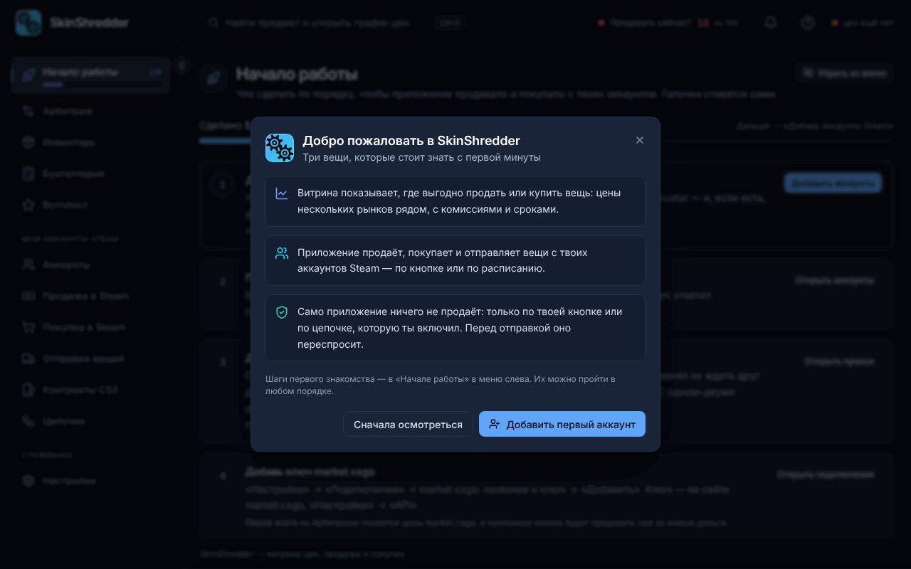

# 🚀 Добро пожаловать в базу знаний CS Trade (SkinShredder)

**CS Trade (SkinShredder)** — это профессиональный инструмент для автоматизации торговли скинами CS2, вывода баланса Steam в реальные деньги и управления фермами аккаунтов любого масштаба (от 1 до 500+ штук).

---

### 💡 В чём главная идея программы?

В трейдинге скинами главное — не просто купить дешевле и продать дороже, а чётко понимать: **«Сколько РЕАЛЬНЫХ денег придёт мне на руки после всех комиссий, блокировок и удержаний?»**.

Большинство таблиц и сервисов показывают завышенные проценты прибыли по завышенным ценам лотов (тролль-листингам), по которым никто никогда ничего не покупает. **CS Trade работает иначе**:
1. **Реалистичный расчёт**: мы берём реальную среднюю цену продаж за 7 дней (`avg7d`), а не случайные завышенные лоты.
2. **Точный учёт комиссий**: учитываются все проценты маркетплейсов и Steam.
3. **Время до денег (`Time to Cash`)**: мы сразу рассчитываем полный срок вывода с учётом 7-дневного трейд-лока Steam и 7-дневного удержания выплаты торговой площадкой (Trade Protection).
4. **Полная автоматизация**: программа не просто показывает цифры, но и сама покупает в Steam по выгодным ордерам, сама продает с сотен аккаунтов, сама подтверждает сделки и сама перекидывает дроп на нужные склады.

---

### 🛡️ Безопасность и архитектура


**Секреты остаются только у вас на компьютере!**
Все файлы авторизации (`maFile`, `vault.key`, логины и пароли) хранятся исключительно локально в зашифрованном виде. Они **никогда не передаются на сторонние серверы**. Даже разработчики программы не имеют доступа к вашим аккаунтам.


* **Серверный скрапер цен**: тяжелый сбор цен со всех рынков и расчет витрины происходят на защищенном сервере. Ваше приложение получает готовый быстрый снимок лучших возможностей, не нагружая процессор и домашний интернет.
* **Локальный движок торговли**: все действия со Steam (вход, выставление лотов, выставление Buy Orders, отправка трейдов, крафт контрактов) выполняются прямо с вашего компьютера через официальные протоколы Steam с поддержкой ваших персональных прокси.
* **Никакого режима «вхолостую»**: в программе нет двойных двусмысленных настроек. Каждая боевая кнопка работает по-настоящему, но перед любым списанием баланса или передачей вещей программа выводит понятное окно подтверждения с точными цифрами и суммами.

---

### 🗺️ Карта документации

| Раздел | Что внутри |
| :--- | :--- |
| [**🏁 Начало работы**](getting-started/overview.md) | Установка, активация подписки и пошаговый запуск программы за 5 минут. |
| [**👥 Аккаунты Steam**](accounts/adding-accounts.md) | Импорт `maFile`, группировка по папкам и тегам, проверка банов, пополнение кошелька кодами и подарки. |
| [**🌐 Прокси**](proxies/proxies-setup.md) | Защита от лимитов Steam (`429 Too Many Requests`) и безопасная работа с десятками аккаунтов. |
| [**📈 Витрина (Арбитраж)**](showcase-and-arbitrage/how-it-works.md) | Поиск лучших предложений для вывода баланса Steam в реальные деньги на market.csgo. |
| [**🛒 Покупка в Steam**](steam-buying/basket.md) | Автоматическая расстановка ордеров (Buy Orders), умная авто-корзина со сканера и контроль балансов. |
| [**🏷️ Продажа в Steam**](steam-selling/sell-flow.md) | Массовый сброс инвентарей, ценовые политики (подрезка лотов, рынок) и защита от случайного слива в минус. |
| [**🚚 Отправка вещей**](item-transfers/trade-offers.md) | Сбор дропа на аккаунты-хранилки в один клик, поддержка CS2, TF2 и Steam-предметов, расчёт «Среднего дропа». |
| [**🔄 Контракты CS2**](trade-ups/trade-up-contracts.md) | Автоматический крафт ширпотреба и армейского качества через Game Coordinator без запуска игры. |
| [**⚡ Автоматизация (Цепочки)**](automation-chains/chain-basics.md) | Визуальный конструктор расписания: от фарма карточек и бесплатных раздач до автопокупки и вывода. |
| [**📦 Инвентарь**](inventory/inventory-analysis.md) | Анализ стоимости инвентарей и вердикт: куда выгоднее продавать каждый скин (напрямую или через Steam). |
| [**📊 Мои сделки (Бухгалтерия)**](portfolio/deal-tracking.md) | Наглядный трекинг каждой купленной вещи: холд, выставление, продажа, чистая прибыль (P&L) и ROI. |
| [**⚙️ Настройки и Telegram**](settings-and-integrations/connections.md) | Подключение API, настройка Telegram-бота для получения отчётов прямо в мессенджер. |
| [**❓ Справка и FAQ**](faq/troubleshooting.md) | Ответы на частые вопросы и разбор распространенных ошибок. |

---


Если у вас возникнут вопросы во время работы с документацией, обратитесь к разделу [**Часто задаваемые вопросы (FAQ)**](faq/faq.md) или напишите в официальную поддержку.

