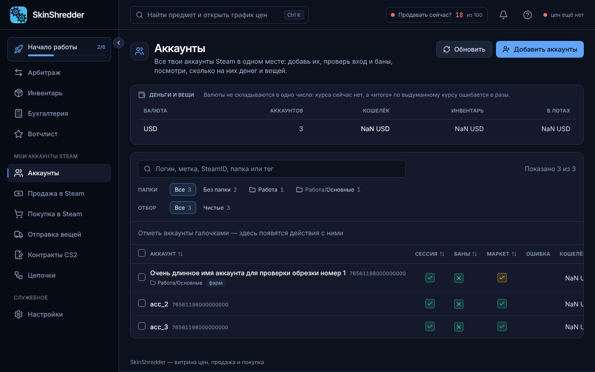
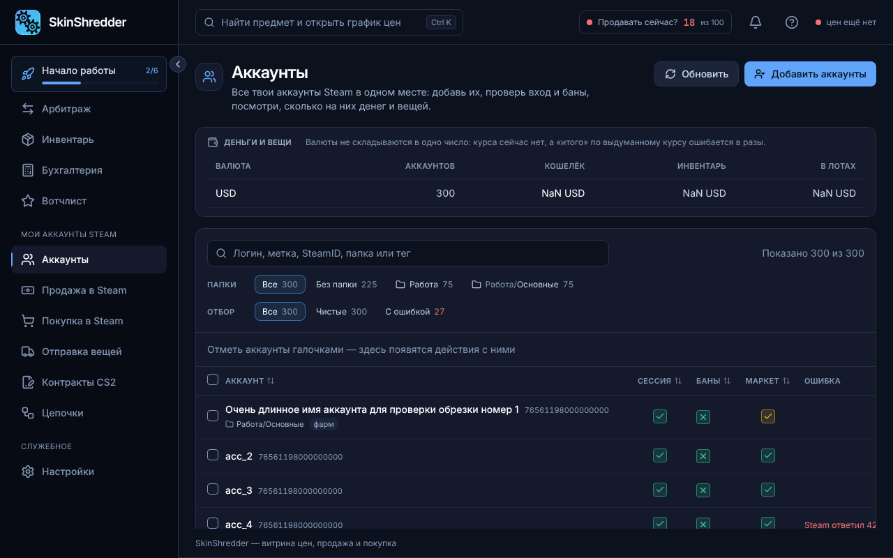

# 👥 Добавление аккаунтов Steam (maFile)

Раздел **«Аккаунты»** — это командный центр для управления вашей фермой. Программа рассчитана на работу как с несколькими личными аккаунтами, так и с сотнями промышленных ботов.



---

### 📂 Что нужно для добавления аккаунтов?

Чтобы программа могла авторизоваться в Steam, запрашивать инвентарь и подтверждать обмены/продажи, необходимы:
1. **Файлы `maFile`** — файлы мобильного аутентификатора Steam Guard, созданные программой *Steam Desktop Authenticator (SDA)* или *ASF (ArchiSteamFarm)*.
2. **Файл с логинами и паролями** — обычный текстовый файл (`.txt`), где на каждой строке указаны данные аккаунта в формате:
   ```text
   логин:пароль
   логин:пароль:дополнительные_данные
   ```


**Полная конфиденциальность!**
Все файлы `maFile` шифруются ключом хранилища `vault.key`, который генерируется локально на вашем ПК. Пароли в открытом виде никогда не сохраняются в интерфейсе.


---

### 🛠️ Пошаговый процесс импорта

1. В правом верхнем углу страницы **«Аккаунты»** нажмите кнопку **«Добавить аккаунты»**.
2. В появившемся окне нажмите **«Выбрать папку с maFile»** и укажите каталог, где лежат ваши `.maFile`.
3. Ниже нажмите **«Выбрать файл паролей»** и укажите текстовый документ со связками `логин:пароль`.
4. Программа автоматически сопоставит имена файлов и логины:
   * **Найдено пар**: аккаунты, у которых есть и `maFile`, и верный пароль.
   * **Только maFile**: есть аутентификатор, но в текстовом файле не найден пароль.
   * **Только пароль**: есть логин с паролем, но отсутствует файл подтверждений.
5. Задайте стартовую **папку** (например, `Фарм CS2` или `Хранилки`) и **теги** (например, `основные`, `дроп`).
6. Нажмите **«Импортировать»**.



---

### ❓ Что делать, если аккаунт добавлен без пароля?

Если у аккаунта есть только `maFile`, программа сможет генерировать 2FA-коды для подтверждения обменов, но не сможет зайти в сессию для проверки баланса или выставления ордеров.
* Чтобы ввести пароль вручную: нажмите иконку **«⋯»** в конце строки аккаунта → **«Войти заново»** → введите логин и пароль.
