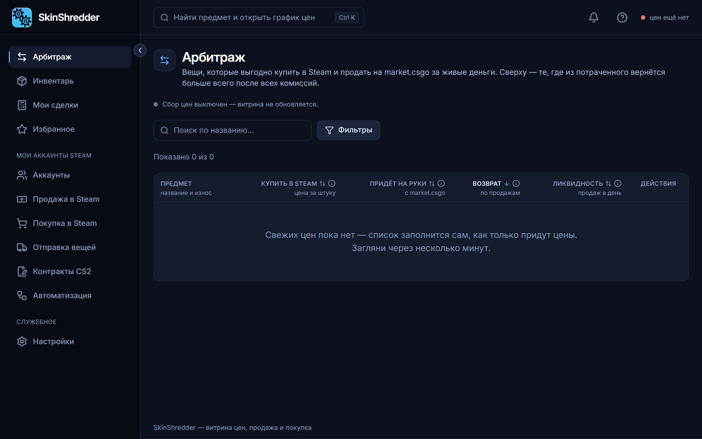

# ⚡ Визуальный конструктор схем (Цепочки)

Раздел **«Автоматизация» (Цепочки)** — это флагманская возможность SkinShredder, превращающая рутинное управление аккаунтами в автономный конвейер.

---

### 🎨 Как устроен интерактивный холст?

Интерфейс представляет собой свободное рабочее пространство (Canvas) со специальными узлами (блоками):
* **Блоки групп аккаунтов**: определяют, КТО будет выполнять действие (например, «Аккаунты фарма дропа», «Хранилки»).
* **Блоки действий**: ЧТО именно нужно сделать (отправить вещи, выставить лоты, купить по ордерам, забрать подарки).
* **Связи (провода)**:
  * 🔵 **Голубой провод («кто / кому»)**: соединяет группу аккаунтов с действием (например, из группы *«Фарм»* во вход *«Кто»* блока *«Отправка»*).
  * 🟣 **Фиолетовый провод («после / готово»)**: задает строгую очередность выполнения (например: *«Покупка»* запускается строго ПОСЛЕ того, как успешно завершилась *«Продажа»*).

---

### 🛠️ Инструменты редактора холста

* **Двойной щелчок по пустому месту холста**: открывает меню быстрого добавления блоков.
* **Вытягивание провода в пустоту**: открывает список совместимых блоков, которые можно подключить к этому гнезду.
* **Кнопка «Разложить»** (в левом верхнем углу): автоматически выравнивает блоки по аккуратным колонкам слева направо.
* **«Во весь экран»**: разворачивает холст на весь монитор для комфортной работы со сложными схемами (выход — клавиша `Esc`).
* **Панель свойств блока**: при клике на любой блок справа плавно выезжает панель детальных настроек.

---

### 💾 Умное автосохранение

Вам не нужно беспокоиться о потере настроек:
* Любое изменение на холсте (перемещение блока, смена цены, смена времени) **автоматически сохраняется в базу через 1 секунду** после последнего действия.
* **Защита включённой цепочки**: если вы внесли правку, которая создает критическую ошибку в схеме (например, оставили блок без группы аккаунтов), автосохранение не сломает работающую цепочку, а вежливо предупредит: *«Изменения не сохранены: с этой правкой включённая цепочка выключилась бы»*.

---

### 🚦 Запуск и контроль исполнения

* **Кнопка «Включить по-настоящему»**: переводит схему в активный режим. Окно покажет список всех шагов и время их запуска.
* **Запуск шага вне очереди**: любой блок можно протестировать в реальном времени, нажав в его свойствах **«Запустить шаг сейчас»**.
* **Правило ожидания ошибок**: если один из промежуточных шагов завершился фатальной ошибкой сети, следующий зависимый шаг не станет рисковать деньгами, а безопасно встанет на паузу со статусом *«пропущен из-за ошибки предыдущего шага»*.
