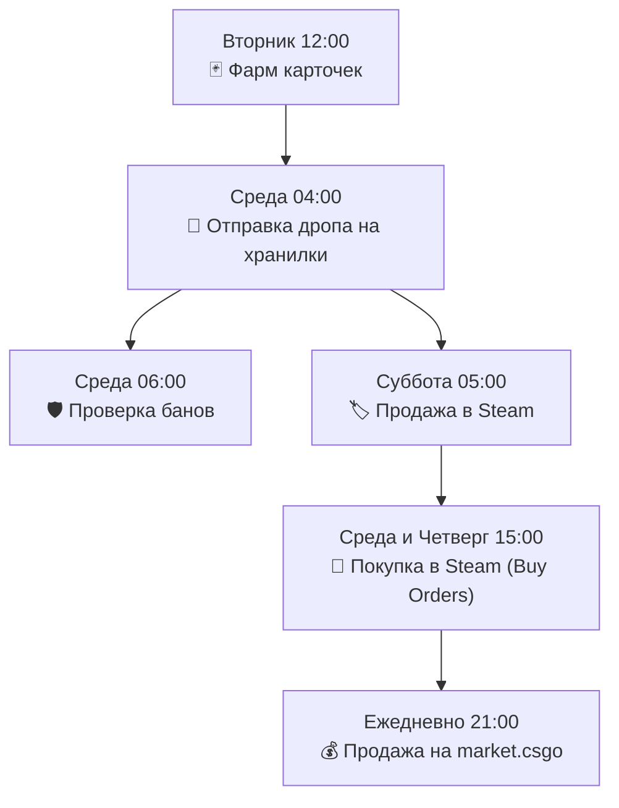

# 📅 Готовый шаблон «Фарм → Хранилки»

Чтобы вам не пришлось собирать расписание с нуля, в программе предусмотрен готовый проверенный шаблон, настроенный под реальную экономику и тайминги обновлений Valve.

---

### 🕒 Еженедельное расписание шаблона (по Москве)

Расписание привязано к сбросу еженедельного дропа CS2 (происходит в ночь со вторника на среду):

| День и время (МСК) | Блок | Почему именно этот тайминг? |
| :--- | :--- | :--- |
| **Вторник 12:00** | 🃏 **Фарм карточек** | До сброса дропа CS2 в среду. Вход клиентом Steam не выбьет фарм активного дропа. |
| **Среда 04:00** | 🚚 **Отправка дропа** | Дроп уже получен за ночь. Все кейсы и скины перекидываются на аккаунты-хранилки. |
| **Среда 06:00** | 🛡️ **Проверка банов** | Контрольная сверка состояния всего парка после массовых обменов. |
| **Суббота 05:00** | 🏷️ **Продажа в Steam** | По субботам и воскресеньям цены на кейсы на ТП Steam достигают пиковых значений из-за высокого онлайна игроков. |
| **Среда / Четверг 15:00** | 🛒 **Покупка в Steam** | Запуск закупки через авто-корзину со сканера на вырученные с продажи кейсов средства. |
| **Каждый день 21:00** | 💰 **Продажа на маркет** | Вечерний пик покупательской активности на market.csgo для максимального темпа продаж. |

---

### ⏳ Учет 7-дневного холда (Лента недели)

Над холстом цепочек расположена интерактивная **лента «Неделя вперёд»**:
* Каждая отправка вещей создает полосу защиты на 7 дней (трейд-лок Steam).
* Если блок продажи на хранилке стоит раньше, чем вещи выйдут из холда, программа выведет предупреждающую карточку:
  * ⚠️ *«Обратите внимание: продажа начнется раньше, чем вещи выйдут из трейд-лока»*.
* В шаблоне «Фарм → Хранилки» все задержки рассчитаны с запасом, исключая холостые прогоны.
