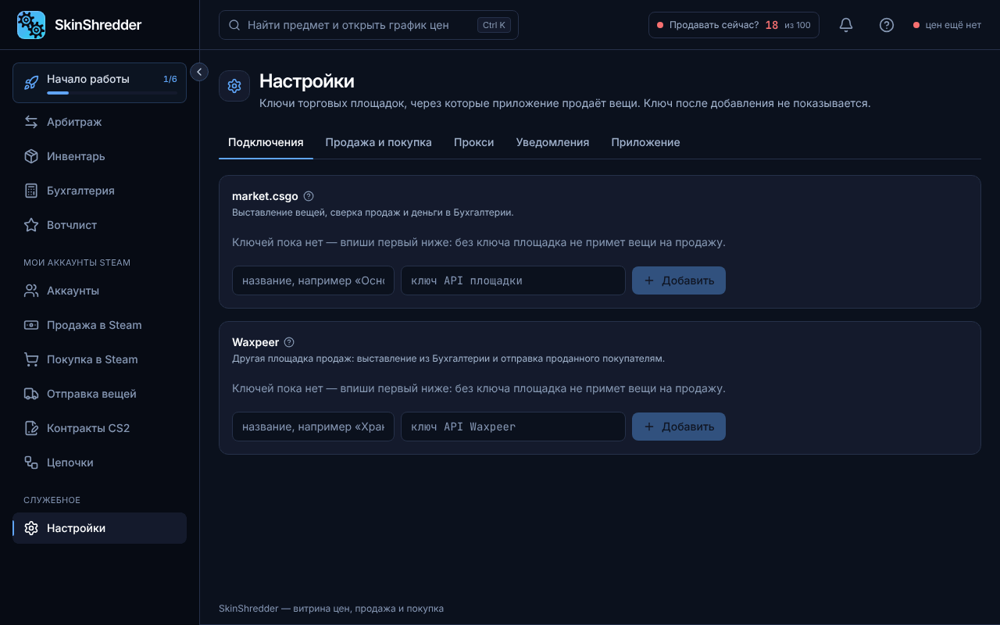

# 📥 Установка и запуск

SkinShredder поставляется в виде удобного установщика для операционной системы Windows.

---

### 💻 Системные требования

* **Операционная система**: Windows 10 или Windows 11 (64-bit).
* **Процессор**: Любой современный процессор (от 2 ядер).
* **Оперативная память**: Рекомендуется от 4 ГБ RAM.
* **Свободное место на диске**: ~500 МБ.
* **Интернет**: Стабильное подключение (для работы сканера и общения со Steam).

---

### 🚀 Пошаговая установка

1. Скачайте установочный файл `SkinShredder Setup.exe` из официального источника (Telegram-канал поддержки или бот подписки).
2. Запустите установщик. Программа автоматически установится и создаст ярлык на рабочем столе.
3. При первом запуске откроется экран запуска приложения и активации подписки.


**Обратите внимание!**
В приложении **нет регистрации по email и паролю**. Доступ активируется только **ключом подписки** вида `cst_...`.
**Ни в коем случае НЕ вводите данные от ваших аккаунтов Steam!** Steam-аккаунты подключаются отдельно в специальном защищённом разделе «Аккаунты».


---

### 🔑 Вход по ключу подписки

Для работы со сканером и движком требуется активная подписка:
1. Получите лицензионный ключ подписки вида `cst_...` в Telegram-боте **@SkinShredderBot**.
2. Вставьте ключ в поле ввода и нажмите кнопку **«Войти»**.
3. Программа свяжется с сервером подписок, подтвердит доступ и запустит рабочие движки (витрину цен и движок торговли).


Приложение запоминает сессию подписки. Если у вас временно пропадет интернет, программа продолжит работать в течение льготного периода (grace period) по последнему сохранённому подтверждению.


---

### 🔄 Автообновление программы

Вам не нужно каждый раз вручную переустанавливать программу:
* При наличии новой версии в правом верхнем углу появится уведомление **«Доступно обновление»**.
* Нажмите кнопку обновления — установщик быстро применит свежие исправления без потери ваших аккаунтов, настроек и прокси.

---

### ⚙️ Фоновая работа и системный трей

Чтобы цепочки автоматизации и проверка ордеров работали непрерывно:
1. Перейдите в **«Настройки» → «Приложение»**.
2. Убедитесь, что включен параметр **«Сворачивать в трей, а не закрывать»** (нажатие на крестик окна свернет программу к часам возле значков Windows).
3. По желанию активируйте **«Запускать вместе с Windows»** — программа будет запускаться в фоновом режиме при каждом включении компьютера.

