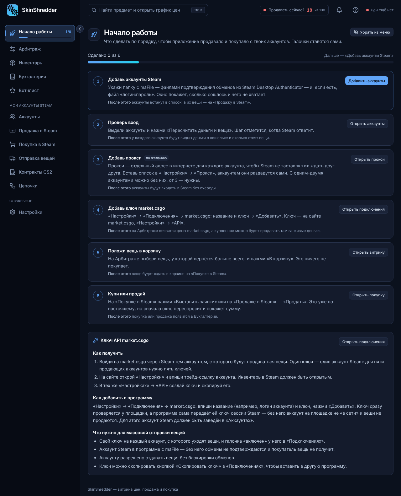

# ⚡ Быстрый старт за 5 минут

При первом входе в программу вы увидите раздел **«Начало работы»** со специальным интерактивным чек-листом.


**Галочки ставятся сами!**
Вам не нужно отмечать пункты вручную. Как только программа зафиксирует реальное действие (например, обнаружение maFile или успешный ответ Steam), чек-лист автоматически обновится.


---

### 📋 6 простых шагов до первой прибыли

#### Шаг 1. Добавьте аккаунты Steam 👥
* Нажмите кнопку **«Добавить аккаунты»** (или перейдите в раздел **«Аккаунты»**).
* Укажите папку, где лежат ваши `maFile` (файлы аутентификатора из Steam Desktop Authenticator) и текстовый файл со связками `логин:пароль`.
* Программа сопоставит файлы и покажет, сколько аккаунтов готово к работе.
* *Результат*: аккаунты появятся в списке, а их инвентари будут готовы к продаже.

#### Шаг 2. Проверьте вход 🔑
* Выделите добавленные аккаунты галочками.
* Нажмите кнопку **«Пересчитать деньги и вещи»**.
* Программа безопасно авторизуется через сессию Steam, запросит баланс кошелька и оценит стоимость инвентаря.
* *Результат*: в строке каждого аккаунта отобразятся точный баланс кошелька и статус работы.

#### Шаг 3. Добавьте прокси (при наличии 3+ аккаунтов) 🌐
* Перейдите в **«Настройки» → «Прокси»**.
* Вставьте список ваших HTTP/SOCKS5 прокси в формате `ip:port:login:password`.
* Программа сама равномерно распределит адреса между аккаунтами.
* *Результат*: аккаунты не будут стоять в очереди и исключат ошибку Steam `429 Too Many Requests`.

#### Шаг 4. Добавьте ключ API market.csgo 🔑
* Перейдите в **«Настройки» → «Подключения»**.
* Нажмите **«Добавить ключ market.csgo»**, введите имя и вставьте ваш API-ключ с сайта маркета.
* *Результат*: на витрине Арбитража мгновенно появятся актуальные цены реальной продажи, и программа сможет рассчитывать чистый возврат средств.

#### Шаг 5. Положите первую вещь в корзину 🛒
* Откройте раздел **«Арбитраж»**.
* Выберите скин с высоким возвратом (например, 85–90%) и хорошей ликвидностью.
* Нажмите иконку **тележки («В корзину»)**.
* *Результат*: этот скин появится в разделе **«Покупка в Steam» → «Корзина»**.

#### Шаг 6. Выставите заявку на покупку 💰
* Откройте **«Покупка в Steam»**.
* Выберите аккаунт(ы), с которого хотите совершить покупку.
* Нажмите кнопку **«Выставить заявки»**.
* Программа покажет окно подтверждения с точной ценой ордера в валюте вашего кошелька. После подтверждения ордер мгновенно появится в Steam!
* *Результат*: когда скин выкупится, он автоматически появится в разделе **«Мои сделки»** для дальнейшей продажи.
