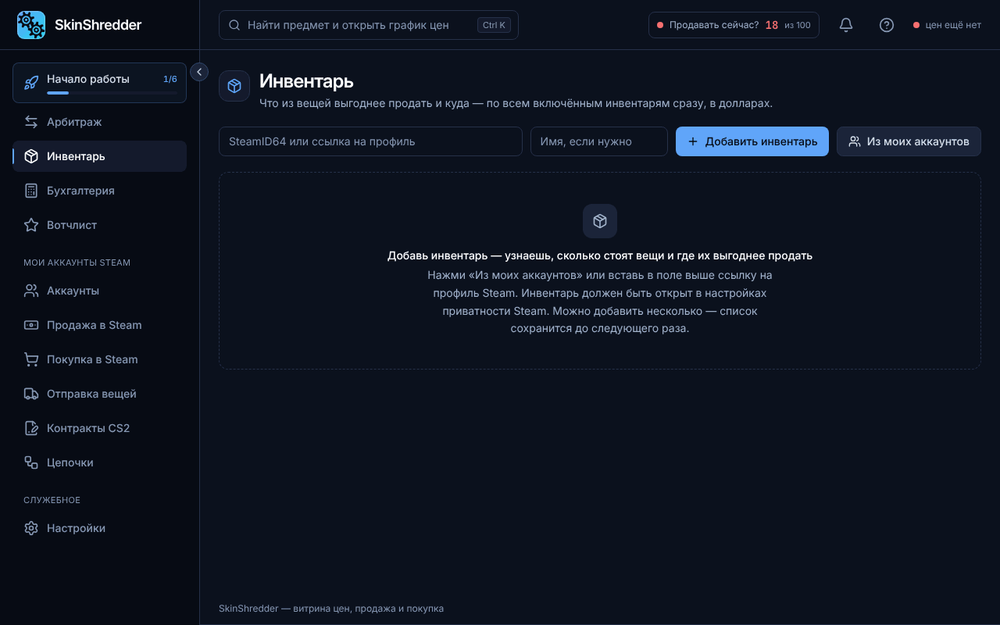
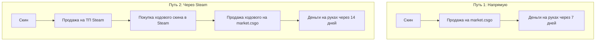

# 📦 Инвентарь: Куда выгоднее продавать

Раздел **«Инвентарь»** проводит детальный аудит любого инвентаря CS2 и отвечает на главный вопрос: **как выжать максимум реальных денег из имеющихся вещей?**

---

### 📥 Добавление инвентарей для анализа

* **Кнопка «Из моих аккаунтов»**:
  Позволяет в 1 клик выбрать любого вашего бота из базы (с удобной фильтрацией по папкам). Программа сама подставит `SteamID64`.
* **Добавить по ссылке**:
  Вставьте публичную ссылку на профиль Steam или Trade URL любого пользователя.
* *Лимит*: до 10 активных инвентарей в списке.

---

### 🔀 2 режима аналитики

Вверху страницы находится переключатель режимов:

#### 1. Режим «Сколько вернётся» 💰
Классическая оценка:
* **Стоит в Steam**: суммарная стоимость всех вещей по ценам лотов ТП Steam.
* **Придёт на руки с market.csgo**: чистая выплата после комиссии площадки.
* **Средний возврат**: процент окупаемости (например, `83.4%`).

#### 2. Режим «Куда продавать» (Умный маршрутизатор) 🧠
Сравнивает два альтернативных пути вывода:

* **Плитка «Сразу на market.csgo»**: сколько денег принесет прямая продажа.
* **Плитка «Через кошелёк Steam»**: сколько выйдет, если слить скин на ТП Steam и перелить кошелек через ходовой скин с возвратом 90%+.
* **Вердикт в строке каждого предмета**:
  * 🟢 **«Напрямую»** — лучше продавать сразу на маркетплейсе (экономит 7 дней ожидания).
  * 🔵 **«Через Steam»** — лучше сначала продать в Steam, так как прямая цена на маркете сильно занижена.


Курс перелива через Steam рассчитывается как честная **медиана по всем ходовым предметам**, а не по 2–3 случайным аномальным скинам.

