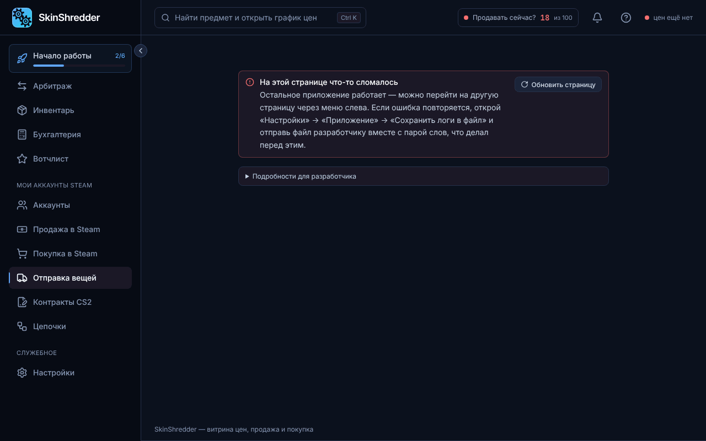

# 🚚 Массовые обмены (Trade Offers)

Раздел **«Отправка вещей»** решает ключевую задачу фермы аккаунтов: сбор еженедельного дропа (кейсы, скины) или купленных вещей со всех ботов-отправителей на один или несколько аккаунтов-хранилищ (хранилок).

---

### ⚠️ Важнейшие правила безопасности трейдов


**Передача предметов необратима!**
Листинг на маркете можно снять, ордер можно отменить, но отправленный и принятый трейд отозвать невозможно. Поэтому боевая отправка всегда показывает окно со списком получателей и количеством передаваемых скинов перед стартом.


* **Только свои аккаунты**: программа создана для перемещения предметов между вашими собственными аккаунтами. Получатель выбирается либо из базы программы, либо по трейд-ссылке.
* **Автоматическое подтверждение 2FA**: созданные трейды автоматически подписываются ключами `maFile` отправителей.

---

### 📦 Защита от переполнения инвентаря (Лимит 1000 предметов)

Инвентарь CS2 вмещает ровно **1000 предметов**. Если отправить трейд на аккаунт, у которого уже 950 вещей, а в трейде 100 предметов — Steam отклонит весь обмен целиком!

**Как это решено в CS Trade**:
1. Вы можете указать **нескольких получателей (хранилок)** в порядке приоритета.
2. Программа проверяет свободное место на первой хранилке.
3. Когда лимит приближается к пределу, отправка автоматически переключается на следующее хранилище в списке!

---

### 🎮 Поддерживаемые типы предметов

С помощью переключателей в шапке вы можете выбрать, из каких игр отправлять вещи:
* 🔫 **Вещи CS2**:
  * Фильтрация по категориям (Кейсы, Скины оружия, Наклейки, Граффити).
  * Фильтр по названию: «только с текстом в имени» или «кроме текста».
* 🔑 **TF2**: мгновенная отправка ключей Манн Ко (Mann Co. Supply Crate Key) для фиксации баланса или мешков с самоцветами.
* 🃏 **Steam**: коллекционные карточки, фоны профиля и смайлики.
* *Можно выбрать несколько категорий одновременно!*

---

### 🚀 Порядок отправки

1. Выберите аккаунты-отправители (по папке `Фарм` или галочками).
2. Выберите аккаунты-получатели.
3. Отметьте нужные категории вещей (например, только `Кейсы CS2`).
4. Нажмите **«Отправить вещи»** → проверьте сводку в окне подтверждения → подтвердите отправку.
5. Программа обойдет всех отправителей, сформирует предложения обмена и сама подтвердит их через мобильный аутентификатор.
