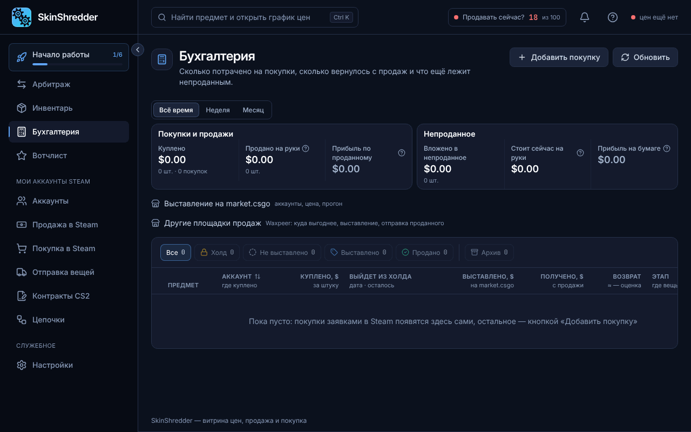
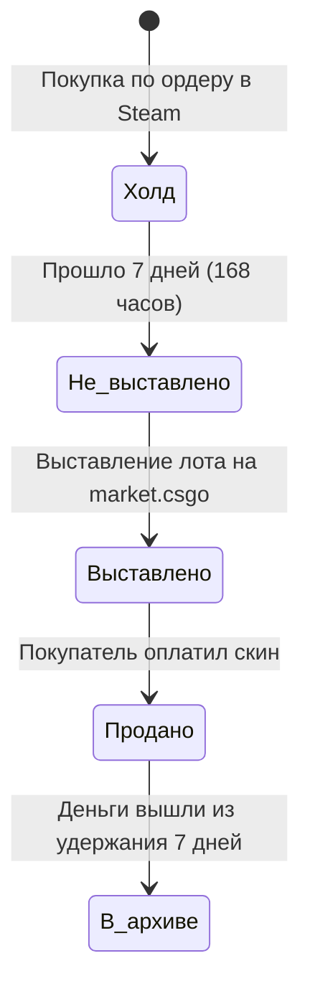

# 📊 Жизненный цикл сделки (Холд → Выплата)

Раздел **«Мои сделки» (Бухгалтерия)** — это финансовый журнал, где каждая купленная позиция ведет строгий учет от момента покупки до поступления живых денег на ваш счет.

---

### 🔄 4 этапа жизненного цикла предмета

Каждая строчка проходит путь через 4 последовательных статуса:

1. 🔒 **«Холд»**:
   * Скин только что куплен в Steam.
   * На нем висит 7-дневная блокировка обмена (Trade Lock). В колонке «Выйдет из холда» тикает точный обратный таймер (в днях и часах).
2. 📦 **«Не выставлено»**:
   * Срок трейд-лока истек.
   * Скин готов к передаче и выставлению на продажу. Выделите строку галочкой и нажмите **«Выставить»**!
3. 🏪 **«Выставлено»**:
   * Предмет выставлен на market.csgo.
   * Отображается установленная цена. При необходимости можно изменить цену прямо из таблицы.
4. 💰 **«Продано»**:
   * Предмет куплен реальным человеком!
   * Зафиксирована точная полученная выплата (`Получено, $`). Под суммой отображается таймер разморозки средств площадки: **«до денег N дн / N ч»**.

---

### 🗄️ Автоархивирование

Вам не нужно вручную очищать таблицу от сотен закрытых сделок:
* Когда по проданному предмету заканчивается 7-дневное удержание средств маркетплейсом (деньги стали полностью свободными), программа **автоматически переносит строку во вкладку «Архив»**.
* При этом все заработанные деньги и статистика навсегда сохраняются в ваших общих отчетах доходности!
