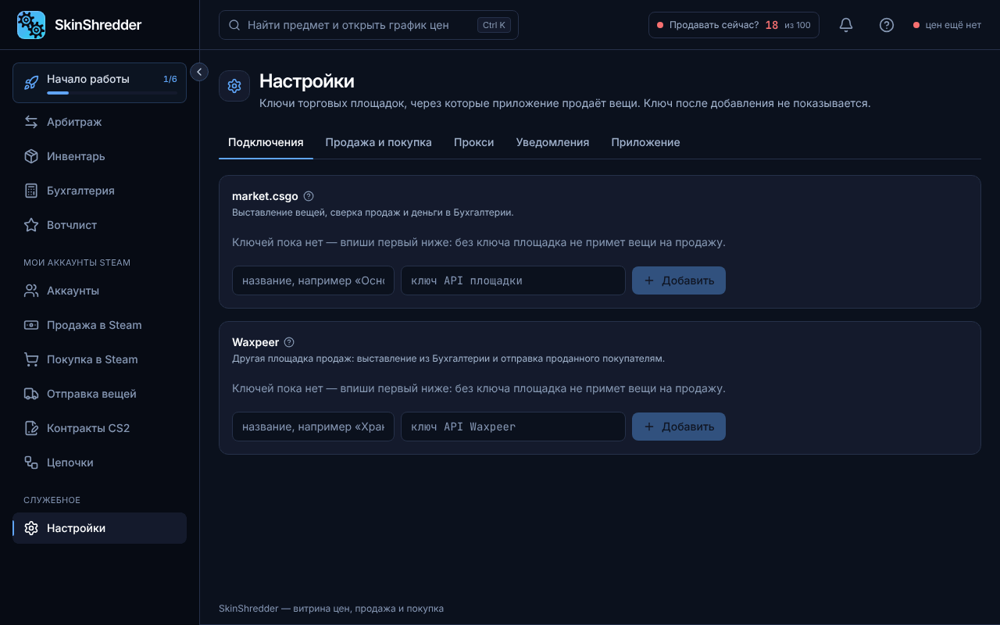

# 🔌 Подключение API market.csgo

Вкладка **«Настройки» → «Подключения»** связывает приложение с внешними торговыми площадками.

---

### 🔑 Зачем нужен ключ market.csgo?

Площадка **market.csgo** — это главный рынок вывода скинов в реальные деньги в CS Trade.
Ключ API необходим, чтобы:
1. Витрина Арбитража получала актуальные цены реальной продажи.
2. Программа могла автоматически выставлять лоты с ваших ботов.
3. Раздел «Мои сделки» автоматически отслеживал продажи и зачисления средств.

---

### 🛠️ Где взять и как добавить ключ?

1. Перейдите на сайт **market.csgo** (cs2market).
2. Зайдите в **«Настройки»** вашего профиля на сайте $\rightarrow$ найдите блок **«API Ключ»**.
3. Скопируйте ваш секретный ключ API.
4. В приложении CS Trade откройте **«Настройки» → «Подключения»**.
5. В блоке market.csgo введите произвольное понятное имя (например, `Основной маркет`) и вставьте скопированный ключ.
6. Нажмите кнопку **«Проверить»**:
   * Программа выполнит тестовый запрос без списания средств.
   * Статус в углу карточки сменится на зеленый: **«работает»**.
7. Нажмите **«Сохранить»**.


В целях безопасности полный ключ в интерфейсе больше никогда не отображается — только его последние 4 символа (например: `задан · ...ab12`). Вы можете в любой момент скопировать полный ключ в буфер обмена нажатием на специальную иконку копирования.

