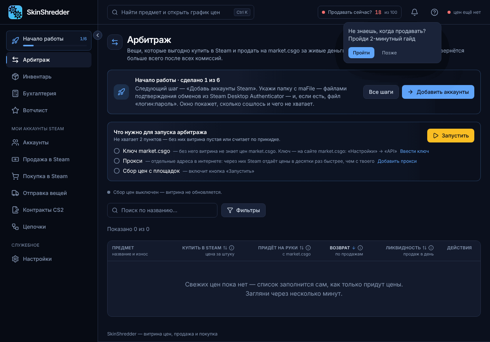
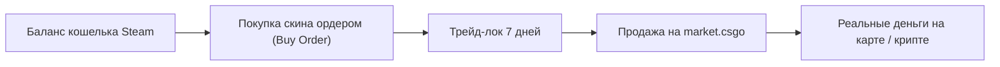

# 📈 Как работает сканер цен (Арбитраж)

Раздел **«Арбитраж»** — это сердце аналитики SkinShredder. Здесь вы находите связки скинов, которые дают максимальный профит при выводе баланса.

---

### 🔄 Базовая модель: Cashout (Вывод со Steam)

В отличие от устаревших сервисов, которые сравнивают случайные рынки, SkinShredder сфокусирован на самом востребованном и надежном сценарии:

#### Почему именно ордера на покупку в Steam?
Если покупать скины в Steam по цене лота (прямо с витрины ТП), вы сразу переплачиваете 10–25%. Программа находит предметы, где ордера на покупку (Buy Orders) стоят значительно ниже рыночной цены, но при этом часто исполняются!

---

### ☁️ Серверный сбор цен

Чтобы не нагружать ваш компьютер и не расходовать лимиты ваших домашних прокси:
* Мощный сервер SkinShredder круглосуточно сканирует рынки:
  * **Steam Community Market** (цены живых лотов `ask` и история реальных продаж).
  * **market.csgo** (актуальные цены продажи и глубина спроса).
* Ваше приложение каждые несколько минут получает готовый легковесный снимок каталога.
* Вы всегда видите самые свежие котировки без задержек и лагов.

---

### 🛒 Быстрый перенос в модуль покупки

В каждой строке витрины есть кнопка **«В корзину» (значок тележки)**:
1. Вы нашли привлекательный скин с высоким возвратом.
2. Нажимаете **«В корзину»**.
3. Предмет моментально отправляется в модуль **«Покупка в Steam»**, где программа сама рассчитает нужную цену ордера в валюте каждого вашего кошелька.
