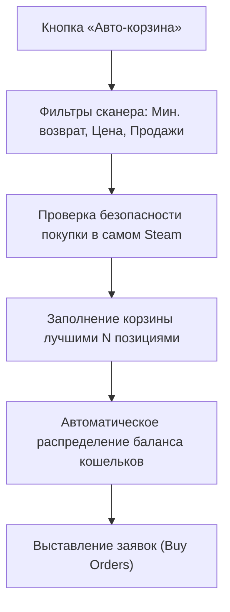

# 🤖 Авто-корзина со сканера

**Авто-корзина** — это продвинутая функция полуавтоматической закупки, которая избавляет вас от необходимости вручную изучать витрину и добавлять скины по одному.

---

### 💡 Как это работает?

Вместо ручного выбора предметов вы задаете правила отбора, и программа сама опрашивает серверный сканер, находит **топ лучших позиций** и распределяет бюджет ваших аккаунтов.

---

### 🎛️ Настройка параметров авто-корзины

1. В разделе **«Покупка в Steam»** нажмите кнопку **«Авто-корзина»** в шапке панели.
2. Задайте параметры:
   * **Сколько лучших позиций брать**: например, 5 или 10 скинов для диверсификации портфеля.
   * **Сколько баланса раскладывать, %**: какую долю свободных денег кошельков выделить на закупку (например, 80%).
   * **Фильтры витрины**:
     * *Цена покупки от / до, \$*
     * *Возврат от, %*
     * *Продаж в день от*
     * *Оценка позиции от (Score)*
   * **Кнопка «Взять фильтры из сканера»**: копирует текущие настройки поиска со страницы «Арбитраж».

---

### 🛡️ Встроенные проверки качества позиций

Программа автоматически применяет строгие защитные фильтры:
* ✅ **Не брать «цена завышена» и «цена спорная»**: исключает любые неликвидные позиции и манипуляции со стаканом.
* ✅ **Не брать оценочные цены («средняя продаж»)**: попадают только предметы с живыми подтвержденными лотами.
* ✅ **Проверка покупки в самом Steam**: сканер витрины оценивает продажи на маркете, а алгоритм авто-корзины дополнительно запрашивает суточный объем продаж внутри самого Steam Community Market. Если скин продается в Steam слишком редко, он будет отсеян!

---

### 🚀 Заполнение корзины

* В блоке **«Сейчас взяла бы»** вы увидите предварительный список скинов, отобранных прямо сейчас.
* Нажмите кнопку **«Заполнить корзину»**.
* Корзина заполнится идеальными позициями, после чего вы сможете в 1 клик нажать **«Выставить заявки»**.
