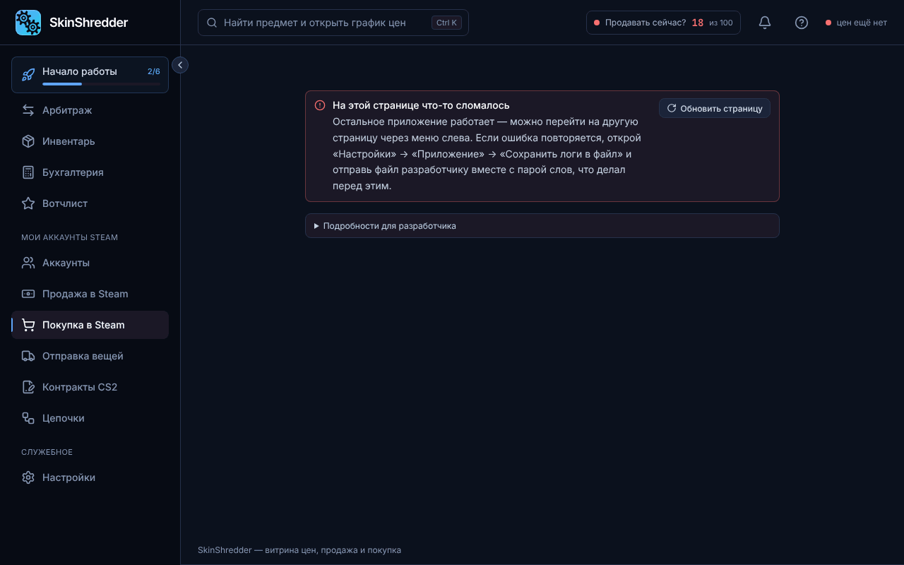

# 🛒 Корзина покупок

Раздел **«Покупка в Steam» → «Корзина»** предназначен для точной расстановки ордеров на покупку (Buy Orders) на выбранных аккаунтах.

---

### 📥 Как предметы попадают в корзину?

1. **С витрины «Арбитраж»**: нажатием кнопки «В корзину» у любого понравившегося скина.
2. **Вручную через поиск**: введите точное название предмета на английском языке прямо в форму добавления корзины.
3. **Через функцию «Авто-корзина»**: автоматический подбор топа предметов по вашим критериям.

---

### ⚙️ Настройки позиций в корзине

Для каждой добавленной вещи вы можете настроить:
* **Количество (Шт.)**: сколько копий предмета вы хотите выкупить.
* **Режим расчёта цены ордера**:
  * **Оптимальная**: умная цена, которая конкурирует с лучшим ордером в стакане Steam, но не переплачивает лишнего.
  * **Подрезать на шаг**: выставить ордер ровно на 1 копейку/цент выше текущего наивысшего ордера на покупку (чтобы стать первым в очереди на выкуп).
  * **По рынку**: ордер по текущей медианной цене.
  * **Фиксированная цена**: жестко заданная сумма покупки.
* **Покупать снова**: если включить эту галочку, после выкупа очередной штуки программа автоматически переставит ордер заново, пока не будет набран нужный лимит.

---

### 👥 Выбор аккаунтов-покупателей

В блоке **«С каких аккаунтов покупаем»**:
* Выберите один или несколько аккаунтов галочками (можно фильтровать по папкам и тегам).
* Возле каждого аккаунта программа показывает **доступный баланс кошелька** и время последней проверки.
* **Распределение бюджета**:
  * *Поровну*: ордера на выбранные вещи выставляются на каждый отмеченный аккаунт.
  * *% от баланса*: программа тратит не более указанного процента от свободных денег кошелька каждого бота.

---

### 🚀 Выставление заявок

1. Нажмите желтую кнопку **«Выставить заявки»**.
2. Откроется окно подтверждения:
   * Программа покажет список аккаунтов, наименования скинов, точные цены в валюте каждого аккаунта и суммарные затраты.
3. Нажмите **«Подтвердить»**.
4. Программа отправит запросы в Steam. Деньги на кошельках зарезервируются под выставленные ордера.
