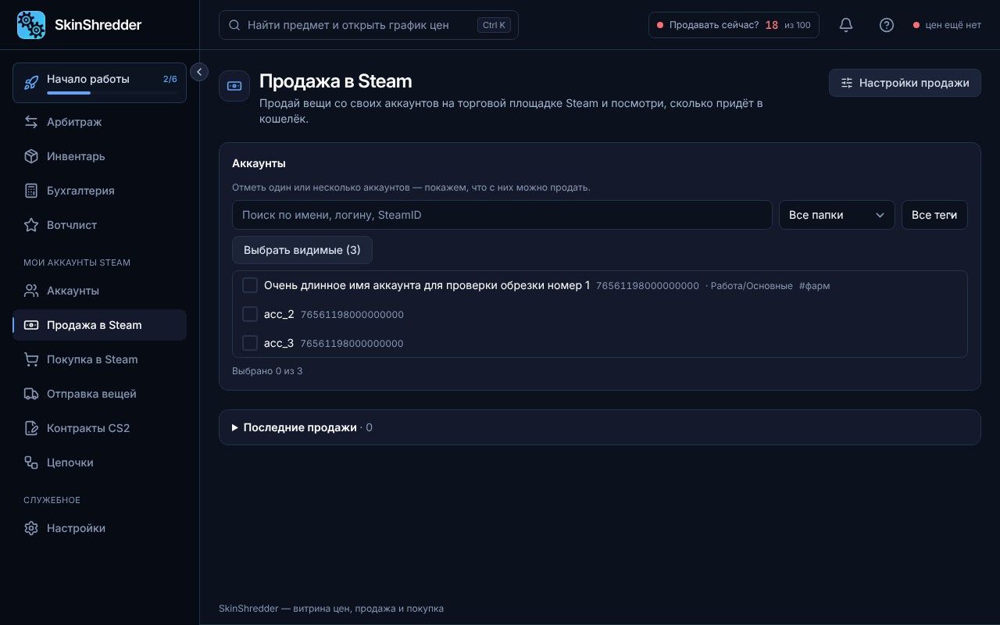
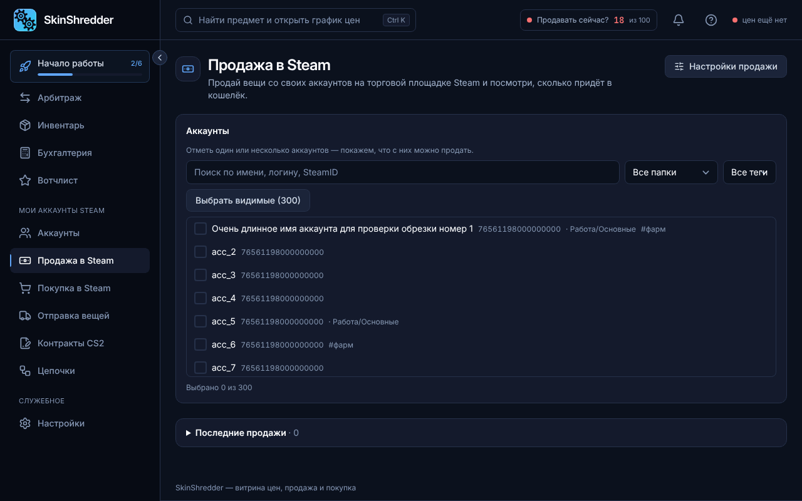

# 🏷️ Выставление предметов на продажу в Steam

Раздел **«Продажа в Steam»** позволяет массово выставлять скины на торговую площадку Steam сразу с десятков и сотен аккаунтов без ручного подтверждения в телефоне.

---

### 🚀 Пошаговый процесс продажи

Весь процесс укладывается в 4 простых шага:

#### Шаг 1. Выберите аккаунты-продавцы
* В блоке «Аккаунты» отметьте галочками ботов, чьи инвентари нужно выставить на продажу.
* Используйте быстрый отбор по папкам (например, `Фарм`) или тегам.
* Программа прочитает инвентари и сформирует единый список предметов.

#### Шаг 2. Отфильтруйте вещи («Что продаём»)
* **Категории CS2**: кнопки быстрого выбора (Оружие, Ножи, Перчатки, Кейсы, Наклейки и т.д.).
* **Только эти категории / Кроме этих категорий**: например, можно выставить только кейсы, оставив скины оружия.
* **Галочка «Скрыть купленное для market.csgo»**:
  
  **Критически важная защита!**
  Включена по умолчанию. Программа автоматически скрывает из списка продажи те скины, которые были закуплены заявками для дальнейшего вывода на маркетплейс, чтобы вы случайно не продали их обратно в кошелек Steam!
  

#### Шаг 3. Выберите ценовую стратегию
* Укажите способ формирования цены (подробнее в следующей статье [Ценовые стратегии](price-strategies.md)).
* Программа моментально пересчитает цену каждого предмета и покажет итоговую сумму: **«Придёт в кошельки: \$X»**.

#### Шаг 4. Нажмите «Продать вещи»
* Откроется диалоговое окно подтверждения:
  * Список аккаунтов и количество предметов.
  * Точные цены продажи по каждому лоту.
* После нажатия **«Подтвердить»** программа сама создаст листинги в Steam и автоматически подтвердит их через `maFile`!

