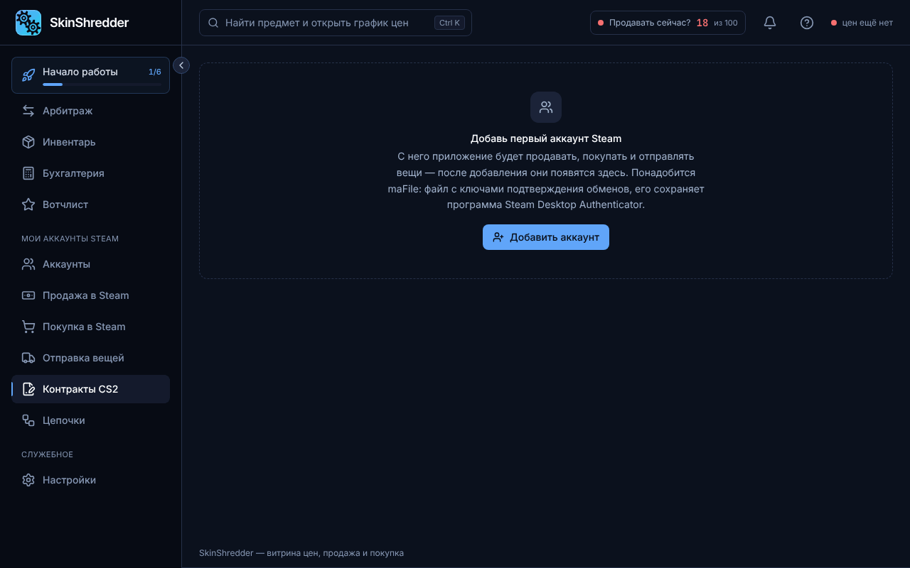

# 🔄 Контракты CS2 (Trade-Up)

Раздел **«Контракты CS2»** позволяет автоматически объединять 10 предметов одного качества в 1 предмет более высокого качества (Trade Up Contract).

---

### 🚀 Главное преимущество: Без запуска CS2!

Обычно для контракта обмена требуется:
1. Запустить тяжелый клиент CS2 на компьютере.
2. Авторизоваться в аккаунт.
3. Вручную прокликивать 10 скинов в меню контракта.
4. Повторить для каждого бота...

**Как это реализовано в SkinShredder**:
* Программа связывается напрямую с сетевым координатором Valve (**Game Coordinator CS2**) по бинарному протоколу Protobuf.
* **CS2 не скачивается и не запускается**. Контракты рассчитываются и выполняются за считанные секунды в фоновом режиме даже на слабом компьютере или VPS!

---

### 🪜 Выбор грейда (качества)

В выпадающем списке доступен крафт по всем стандартным ступеням:
1. **Ширпотреб (Consumer Grade)** $\rightarrow$ Промышленное качество
2. **Промышленное (Industrial Grade)** $\rightarrow$ Армейское качество
3. **Армейское (Mil-Spec Grade)** $\rightarrow$ Запрещенное качество
4. **Запрещенное (Restricted)** $\rightarrow$ Засекреченное качество
5. **Засекреченное (Classified)** $\rightarrow$ Тайное (Covert)

* Доступен выбор: **Обычные скины** или **StatTrak™**.

---

### ⚠️ Подготовка инвентаря: Снятие зависших лотов


Предметы, выставленные на Торговой площадке Steam, заблокированы ТП и не видны игровому координатору!

Если ваши дешевые скины или ширпотреб стоят на продаже:
* Нажмите кнопку **«Снять лоты перед крафтом»**.
* Программа сама снимет лоты выбранного грейда с маркета, вернет их в активный инвентарь и сделает доступными для контракта.

---

### 📋 Два режима: «Рассчитать план» и боевой запуск

1. **Кнопка «Рассчитать план»**:
   * Сканирует инвентари выбранных ботов.
   * Показывает, сколько полных десяток скинов набралось и сколько контрактов получится скрафтить.
   * **Действие безопасно — скины не сгорают**.
2. **Кнопка «Выполнить контракты»**:
   * Запрашивает явное подтверждение с числом сжигаемых предметов.
   * Отправляет пакетные запросы в координатор Valve.
   * Новые полученные скины более высокого качества моментально появляются в инвентаре!
