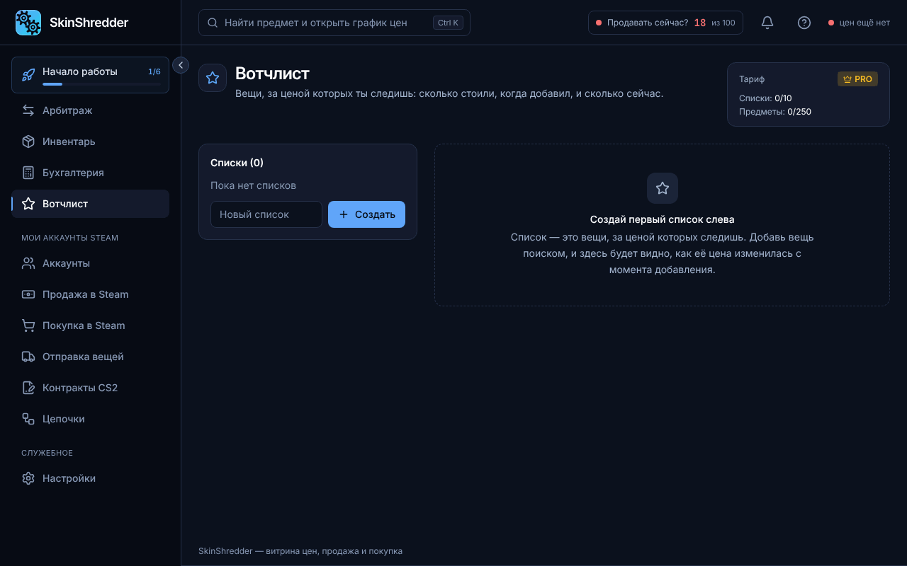

# ⭐ Отслеживание скинов (Избранное)

Раздел **«Избранное» (Вотчлист)** позволяет вести персональный список скинов, за динамикой которых вы хотите следить постоянно.

---

### 📌 Зачем нужно Избранное?

* **Поиск момента для входа**: вы знаете, что определенный нож или перчатки периодически проседают в цене ордеров в Steam. Добавьте их в Избранное, чтобы не искать заново в общем каталоге.
* **Быстрый переход к покупке**: из строки Избранного можно в один клик отправить скин в корзину покупок.
* **Контроль спреда**: вы сразу видите, если возврат по вашей любимой позиции подскочил с 82% до 94%.

---

### ➕ Как добавить скин в Избранное?

1. Откройте витрину **«Арбитраж»**.
2. В строке любого предмета нажмите на контурную **звездочку (⭐)** слева от названия.
3. Звездочка загорится желтым цветом — предмет моментально появится в разделе **«Избранное»**.
4. Чтобы удалить скин из отслеживания, повторно нажмите на звездочку.
